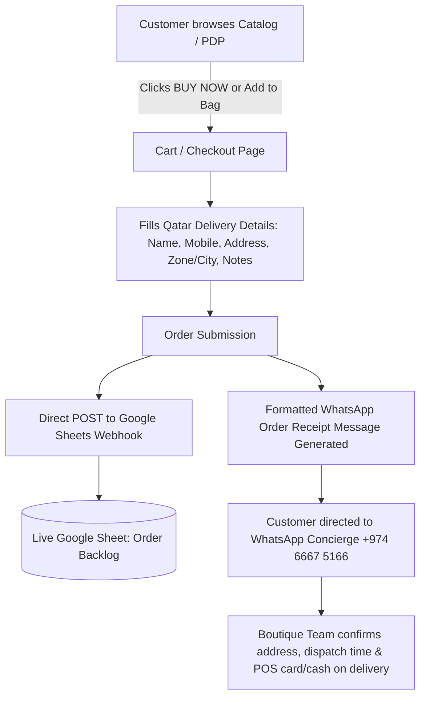

# LUMÈRA LUXE — Comprehensive Website & Architecture Manifest

> **System Blueprint & Technical Reference for Feature Expansion**  
> *Last Updated: October 2026*  
> *Authoritative source for codebase architecture, data schemas, design tokens, state management, and extension guidelines.*

---

## 1. Executive & Brand Overview

| Attribute | Specification |
|:---|:---|
| **Brand Name** | **LUMÈRA LUXE** |
| **Brand Tagline** | *Where Luxury Meets Affordability* |
| **Legal Entity** | Lumera Luxe Perfumes and Cosmetics W.L.L. (شركة لوميرا لوكس للعطور ومستحضرات التجميل ذ.م.م) |
| **Commercial Registration (CR)** | #253967 (Ministry of Commerce & Industry — State of Qatar) |
| **Headquarters & Dispatch** | Doha, State of Qatar (Nationwide VIP Courier Delivery) |
| **Operating Model** | Boutique Haute Parfumerie with Assisted Concierge WhatsApp Order Verification, Direct POS Cash/Card on Delivery, and Corporate QNB Bank Transfer. |
| **Active Catalog** | **175 Curated Luxury Fragrances** (Designer houses: Chanel, Dior, Tom Ford, Hermès, Guerlain, Byredo, Boucheron, Chopard, Armani, YSL, Givenchy, etc.) |

---

## 2. Technology Stack

- **Core Framework**: [Astro v5](https://astro.build/) (`astro.config.mjs`, `@astrojs/sitemap`)
  - Zero-JS static generation by default with targeted client-side interactive islands (`client:load` / native web components).
  - Sub-second build times (~900ms for 189 static pages).
- **Language**: TypeScript 5.7+ (Strict type checking, ES Module syntax).
- **Styling Architecture**: Vanilla CSS with comprehensive Design System CSS Custom Properties (`src/styles/global.css`).
  - *No TailwindCSS* — direct CSS token control, fluid clamping (`clamp()`), and pristine luxury aesthetics.
- **Client Storage & State**: Native browser `localStorage` + standard DOM CustomEvents (`bag-updated`, `favorites-updated`).
- **Catalog & Asset Pipeline**:
  - Python 3 + Pillow (PIL) for image optimization (600×600 WebP square canvases, LANCZOS resampling).
  - OpenPyXL for synchronized multi-tab Excel (`.xlsx`) and CSV catalog generation.
- **Backend Integrations**:
  - WhatsApp Business API deep links with formatted multi-line cart receipts.
  - Google Apps Script Webhook endpoint (`google-sheets-order-sync.gs`) for zero-cost real-time order logging into Google Sheets.

---

## 3. Directory & File Structure

```
/Users/LUMÈRA_LUXE/
├── astro.config.mjs                 # Astro configuration with sitemap integration
├── package.json                     # Node dependencies and build scripts
├── tsconfig.json                    # TypeScript strict compiler config
├── WEBSITE_MANIFEST.md              # THIS DOCUMENT — Complete technical architecture
├── BANK_READINESS_AUDIT.md          # MoCI & Qatar bank readiness compliance documentation
├── Lumera_Luxe_Catalog_Products.xlsx# Master 175-product 4-sheet client spreadsheet
├── Lumera_Luxe_Catalog_Products.csv # Master UTF-8-SIG (Excel-compatible) catalog CSV
│
├── public/                          # Static public web assets
│   ├── assets/
│   │   ├── products/                # 175+ optimized 600x600 .webp fragrance flacon photos
│   │   └── editorial/               # Hero & story high-fashion banners
│   ├── downloads/                   # Publicly downloadable CSV and XLSX catalogs
│   ├── favicon.svg                  # Brand favicon
│   ├── lumeraluxe logo.svg          # Official vector brand logo
│   ├── robots.txt                   # Search engine crawl directives
│   └── _headers                     # Security headers & cache-control directives
│
├── src/
│   ├── components/                  # Reusable Astro UI components
│   │   ├── Header.astro             # Sticky luxury navbar, search trigger, bag & wishlist counts
│   │   ├── Footer.astro             # MoCI registration, legal entity notes, links, payment notices
│   │   ├── ProductCard.astro        # Standardized perfume grid card (crossed-out retail + selling price)
│   │   ├── BagDrawer.astro          # Sliding flyout shopping cart drawer with live subtotal
│   │   ├── WishlistDrawer.astro     # Sliding flyout saved items drawer
│   │   ├── MobileDrawer.astro       # Hamburger navigation drawer for mobile
│   │   └── MobileBottomNav.astro    # Thumb-friendly bottom app bar (Home, Shop, Wishlist, Bag)
│   │
│   ├── data/
│   │   ├── products.json            # MASTER CATALOG: 175 verified fragrances with olfactory notes
│   │   └── site.ts                  # Centralized business info, phone, CR, bank & legal metadata
│   │
│   ├── layouts/
│   │   └── BaseLayout.astro         # HTML5 shell, OpenGraph, JSON-LD, font preload, drawers
│   │
│   ├── lib/
│   │   ├── cart.ts                  # Cart utility types and calculation helpers
│   │   ├── favorites.ts             # Wishlist store with localStorage & event bus
│   │   └── whatsapp.ts              # WhatsApp order receipt generator with formatted text
│   │
│   ├── pages/                       # File-based routing
│   │   ├── index.astro              # Homepage (editorial hero, featured collection, story, trust)
│   │   ├── shop.astro               # Full catalog with brand filter, scent search & sorting
│   │   ├── checkout.astro           # Delivery details form, order review & WhatsApp/Sheet submission
│   │   ├── our-story.astro          # Brand narrative, authenticity guarantee, luxury mission
│   │   ├── contact.astro            # Doha concierge contact, phone, WhatsApp, location info
│   │   ├── delivery-returns.astro   # Qatar delivery policies & Law No. 8 of 2008 returns
│   │   ├── returns-refunds.astro    # Consumer protection refund guidelines
│   │   ├── shipping-delivery.astro  # Delivery timeframe, courier dispatch, Doha hub info
│   │   ├── terms.astro              # Comprehensive terms of service
│   │   ├── privacy.astro            # Qatar Law No. 13 of 2016 privacy compliance
│   │   ├── 404.astro                # Luxury 404 recovery page
│   │   └── perfumes/
│   │       └── [slug].astro         # Dynamic Product Detail Page (PDP) with SEO schemas
│   │
│   └── styles/
│       └── global.css               # Core CSS variables, typography, reset, micro-animations
│
└── scripts/                         # Automation & catalog data tooling
    ├── apply_price_revisions.py     # Ingests comparison Excel, cleans deleted/added items
    ├── generate_catalog_exports.py  # Generates styled multi-tab XLSX & CSV files
    ├── google-sheets-order-sync.gs  # Google Apps Script webhook receiver for orders
    └── fix_missing_images.py        # Validates and downloads missing product WebP images
```

---

## 4. Master Data Models & Schemas

### 4.1 Product Object (`src/data/products.json`)
Every fragrance in the catalog adheres to this strict structure:

```typescript
export interface Product {
  id: string;                  // e.g. "lum_001" (sequential unique identifier)
  row: number;                 // e.g. 1 (1-indexed row number)
  sku: string;                 // e.g. "LL-001" (uniform stock keeping unit)
  slug: string;                // e.g. "aigner-iconista" (URL-safe unique identifier)
  brand: string;               // e.g. "Aigner"
  name: string;                // e.g. "Iconista"
  fullName: string;            // e.g. "Aigner Iconista"
  sizeMl: number;              // e.g. 100
  sizeDisplay: string;         // e.g. "100ml"
  concentration: string;       // e.g. "Eau de Parfum", "Eau de Toilette", "Parfum"
  currency: string;            // "QAR"
  priceMinor: number;          // Selling price in dirhams/cents (e.g. 18000 for 180 QAR)
  priceDisplay: string;        // e.g. "180 QAR" (active customer payment price)
  stickerPriceMinor: number | null; // Original retail market price in dirhams (e.g. 37000 for 370 QAR)
  image: string;               // Path relative to public (e.g. "/assets/products/aigner-iconista.webp")
  category: 'floral' | 'oriental' | 'fresh' | 'woody'; // Primary olfactive pillar
  scentFamilies: string[];     // e.g. ["Floral & Rose", "Floral Oriental"]
  keyNotes: string[];          // e.g. ["Bergamot", "Pink Pepper", "Rose", "Patchouli"]
  rawNotes: string;            // Comma-separated full olfactory pyramid
  description: string;         // Rich luxury editorial description
  featured: boolean;           // true for homepage highlights
  isDraft: boolean;            // false for active store products
  draftReason: string[];       // Empty for verified products
}
```

#### Pricing Representation Rule:
- **`priceMinor` / `priceDisplay`**: The **LUMÈRA Selling Price** (from the *Discounted* column in Excel). This is the amount charged at checkout.
- **`stickerPriceMinor`**: The **Original Retail Price** (from the *Price* column in Excel). When `stickerPriceMinor > priceMinor`, it is displayed crossed-out (`~~370 QAR~~`) to showcase savings.

---

### 4.2 Cart Item (`src/lib/whatsapp.ts`)
```typescript
export interface CartItem {
  id: string;
  name: string;
  brand: string;
  sizeDisplay: string;
  concentration: string;
  priceMinor: number;
  quantity: number;
  image?: string;
}
```

---

### 4.3 Site Configuration (`src/data/site.ts`)
Houses all business entity variables so business changes never require hardcoded search-and-replace:
- WhatsApp number: `97466675166`
- Support email: `concierge@lumeraluxe.qa`
- Legal entity: `Lumera Luxe Perfumes and Cosmetics W.L.L.`
- CR number: `253967`
- Corporate Bank: `Qatar National Bank (QNB)`
- Webhook URL: Google Apps Script endpoint for order sync.

---

## 5. Client-Side State Management & Event Bus

The frontend employs zero heavy client frameworks (no React/Vue runtime overhead). Components communicate seamlessly via native standard browser events:

```
[User Action: Add to Bag] 
       │
       ▼
localStorage['lumera_bag_v1'] updated
       │
       ▼
window.dispatchEvent(new CustomEvent('bag-updated', { detail: { count, items, subtotal } }))
       │
       ├──► Header.astro: updates bag badge count in real time
       ├──► MobileBottomNav.astro: updates mobile bag counter
       └──► BagDrawer.astro: re-renders slide-out drawer items & subtotal
```

```
[User Action: Toggle Wishlist Heart]
       │
       ▼
localStorage['lumera_favorites_v1'] updated via src/lib/favorites.ts
       │
       ▼
window.dispatchEvent(new CustomEvent('favorites-updated', { detail: { favorites, productId, isNowFav } }))
       │
       ├──► Header.astro: updates wishlist badge count
       ├──► MobileBottomNav.astro: updates wishlist count
       ├──► ProductCard.astro: updates heart icon fill state
       └──► WishlistDrawer.astro: re-renders saved flacons
```

---

## 6. Order Placement & Checkout Journey

LUMÈRA LUXE uses a two-tier friction-free concierge ordering architecture:



### Order Reference Format:
- Random 4-digit reference: `#LL-XXXX`
- Includes item details, concentrations, bottle sizes, QAR prices, total items, and full delivery address.

---

## 7. Design System & CSS Variables

Stored in [`src/styles/global.css`](file:///Users/LUMÈRA_LUXE/src/styles/global.css):

### 7.1 Palette
| Variable | Hex / Value | Semantic Role |
|:---|:---|:---|
| `--color-bg-base` | `#FAF8F4` | Primary warm ivory canvas |
| `--color-bg-surface` | `#FFFFFF` | Card & drawer background |
| `--color-bg-subtle` | `#F1EAE2` | Alternating section fills & neutral tags |
| `--color-text-main` | `#1A1816` | Deep ink brown-black for headings & prices |
| `--color-text-body` | `#3A342F` | High-contrast readable body typography |
| `--color-text-muted` | `#7E7873` | Subtitles, sizes, crossed-out original prices |
| `--color-text-light` | `#9E968F` | Micro-labels, border accents, dot separators |
| `--color-brand-cognac`| `#A6532D` | Brand signature warm copper/cognac accent |
| `--color-gold-accent` | `#D4AF37` | Champagne gold badges, star emblems |
| `--color-gold-border` | `#E8DCC8` | Refined metallic card and pill borders |

### 7.2 Typography
- **Serif Display**: `'Cormorant Garamond', Georgia, serif` (hero banners, section titles, luxury headlines).
- **Sans Interface**: `'Inter', system-ui, -apple-system, sans-serif` (body, prices, forms, navigation).

### 7.3 Grid & Responsiveness
- Mobile: 2-column fragrance cards (`gap: 0.75rem` to `1rem`).
- Tablet: 3-column grid.
- Desktop: 4-column luxury showcase (`max-width: 1240px`).
- Touch Targets: Minimum 44×44px / 48×48px with expanded hit areas (`::before`).

---

## 8. Catalog Data & Maintenance Tooling

The [`scripts/`](file:///Users/LUMÈRA_LUXE/scripts/) directory provides complete maintenance tools:

1. **`python3 scripts/apply_price_revisions.py`**:
   - Parses the master comparison workbook `Lumera_Luxe_Qatar_Perfume_Price_Comparison.xlsx`.
   - Filters out yellow-highlighted items (deletions).
   - Ingests green-highlighted items (additions) with complete note pyramids and metadata.
   - Maps retail and discounted prices directly to `stickerPriceMinor` and `priceMinor`.
   - Formats and writes `src/data/products.json`.
2. **`python3 scripts/generate_catalog_exports.py`**:
   - Reads `products.json` and outputs:
     - `Lumera_Luxe_Catalog_Products.xlsx` (4 tabs: All Products, Brand Summary, Category Breakdown, About).
     - `Lumera_Luxe_Catalog_Products.csv` (UTF-8-SIG encoding for Arabic/French character safety in Excel).
     - Syncs copies to `public/downloads/` for instant customer or business partner download.
3. **`scripts/google-sheets-order-sync.gs`**:
   - Standalone Google Apps Script file for deploying a Web App webhook to receive JSON order payloads and populate columns in Google Sheets.

---

## 9. Feature Extension Playbook (How to Build New Features)

### 9.1 Adding a New Fragrance
1. Place a 600×600 square WebP image in `public/assets/products/<slug>.webp`.
2. Add the product record to `src/data/products.json` with unique `id`, `sku`, and `slug`.
3. Run `python3 scripts/generate_catalog_exports.py` to refresh the Excel and CSV files.
4. Run `npm run build` to verify route generation.

### 9.2 Adding a New Scent Family or Filter
1. In `src/data/products.json`, assign the new category (e.g. `'gourmand'` or `'woody'`) and add descriptors to `scentFamilies`.
2. In `src/pages/shop.astro`, add the category pill to the filter buttons. The filtering logic uses data attributes and client-side DOM filtering automatically.

### 9.3 Integrating an Online Payment Gateway (QPay / Dibsy / Stripe)
1. Add gateway credentials to `.env` (`PUBLIC_GATEWAY_KEY`, `GATEWAY_SECRET`).
2. In `src/pages/checkout.astro`, hook the order form submit button to initiate the payment session before dispatching the order summary.
3. Store the returned transaction ID in the order payload sent to the Google Sheets webhook.

### 9.4 Adding Multi-Language Support (Arabic Toggle)
1. `src/data/site.ts` already includes Arabic legal fields (`legalEntityNameAr`).
2. Add an `ar/` route or an Astro i18n routing configuration in `astro.config.mjs`.
3. In `ProductCard.astro` and `[slug].astro`, mirror the RTL direction (`dir="rtl"`) when the active locale is Arabic.

---

## 10. Verification & Quality Commands

```bash
# Start local development server (live on http://localhost:4321/)
npm run dev

# Run full static site production build and route validation
npm run build

# Preview the built production bundle
npm run preview

# Re-generate catalog exports (CSV & XLSX)
python3 scripts/generate_catalog_exports.py
```

---

## 11. Fragrance Discovery & The Art of Layering (PDP Scent Duets)

### Interactive Consultation Quiz (`/fragrance-finder/`)
- **4-Question Interactive Consultation**:
  1. Fragrance Family (`fresh`, `floral`, `gourmand`, `woody_amber`, `surprise`)
  2. Desired Longevity (`light`, `moderate`, `long_lasting`, `no_preference`)
  3. Scent Trail / Sillage (`subtle`, `moderate`, `strong`, `no_preference`)
  4. Occasion Suitability (`everyday_office`, `casual`, `special_occasions`, `evening_events`, `versatile`)
- **Deterministic Matcher Engine** (`src/lib/fragrance-matcher.ts`):
  - Zero external AI dependencies or API failure vectors.
  - Deterministic 4-vector scoring: Family (40%), Longevity Distance (25%), Sillage Distance (25%), Occasion (10%).
  - Category similarity matrix and neutral handling of "no preference".
  - Verified local metadata structure (`src/data/fragrance-metadata.ts`) with zero fabricated performance claims.
  - Generates bespoke match reasons and top 3 recommended flacons with brand diversity.

### Curated Scent Duets (The Art of Layering on PDP)
A dedicated luxury ritual section appearing on 20 participating Product Detail Pages (10 reciprocal pairs).
- **10 Curated Pairings** (`src/data/fragrance-discovery.ts`):
  1. *Velvet Rose & Golden Amber*: Boucheron Ambre d’Alexandrie + Dior Miss Dior
  2. *Mineral Citrus & Royal Oud*: Chopard Oud Malaki + Hermès Eau des Merveilles
  3. *Midnight Orchid & Sacred Incense*: Chopard Black Incense Malaki + Tom Ford Velvet Orchid
  4. *Haute Aldehydes & Sacred Woods*: Boucheron Patchouli d’Angkor + Chanel N°5
  5. *Bahia Citrus & Desert Oud*: Dolce & Gabbana Velvet Desert Oud + Boucheron Orange de Bahia
  6. *Rose Nectar & Venezuelan Tonka*: Boucheron Fève Tonka de Canaima + Parfums de Marly Delina
  7. *Imperial Leather & Moroccan Blossom*: Guerlain Cuir Intense + Yves Saint Laurent Libre
  8. *Carthage Honey Oud & Velvet Tuberose*: Boucheron Oud de Carthage + Carolina Herrera Good Girl
  9. *Crystalline White Musk & Midnight Orchid*: Tom Ford Black Orchid + Narciso Rodriguez Pure Musc
  10. *Smoky Leather & Luminous Mandarin*: Chopard Leather Malaki + Chanel Coco Mademoiselle

### 1-Click Duet Acquisition (`add-duet-to-bag`)
- **Single-Click Cart Addition**:
  - The Layering Card features an *"Add Both to Bag · {duetPriceTotal} QAR"* button.
  - Attributes `data-action="add-duet-to-bag"`, `data-id-1`, and `data-id-2`.
  - Atomically appends both flacons to `localStorage['lumera_bag_v1']`.
  - Triggers toast *"Added Scent Duet (2 flacons) to bag"*, updates header counter badge, and automatically slides open `BagDrawer` so customers immediately see both curated flacons in their bag.

---

## 12. "Discovery" Mega-Dropdown & Scent & Style Hub (`/scent-styling/`)

### Navigation Architecture (`src/components/Header.astro` & `src/components/MobileDrawer.astro`)
- Replaces generic navigation with an editorial **"Discovery ▾"** mega-dropdown.
- Two curated columns:
  - **Scent & Style Alignment**: *Wear with Warm Gold*, *Wear with Cool Silver*, *Wear with Rose Gold*.
  - **Consultation & Rituals**: *Fragrance Finder Quiz*, *The Art of Layering*, *The Elemental Wardrobe*.
- Mobile Navigation includes a streamlined, calm hierarchy: Top utility bar for Wishlist & Bag, quiet inline olfactive accords, and unified Discovery items with informative captions (zero bulky emoji pill bloat).

### Scent & Style Alignment Page (`/scent-styling/`)
- **Precious Metals Accord Alignment**:
  - *Warm Gold* (18k & 21k Gold): Honeyed Amber, Royal Oud, Solar Saffron, Warm Vanilla.
  - *Cool Silver* (Platinum & White Gold): Crystalline Musks, Aldehydes, Clean Iris, Mineral Ambergris.
  - *Rose Gold & Silk*: Turkish Damask Rose, Tart Lychee, Tender Peony, Velvet Cashmere.
- **The Elemental Wardrobe (Zodiac Archetypes)**:
  - Respectfully translates astrological / zodiac personality archetypes into haute perfumery elements without cultural or religious friction in Qatar:
    - *Desert Fire* (Aries, Leo, Sagittarius)
    - *Coastal Air* (Gemini, Libra, Aquarius)
    - *Oasis Earth* (Taurus, Virgo, Capricorn)
    - *Midnight Water* (Cancer, Scorpio, Pisces)
- **Direct Catalog Integration**:
  - Links directly to dynamic catalog filters: `/shop/?style=gold`, `/shop/?style=silver`, `/shop/?style=rose-gold`.
  - `shop.astro` supports live client-side filtering and removable filter pills for all 4 styles.


